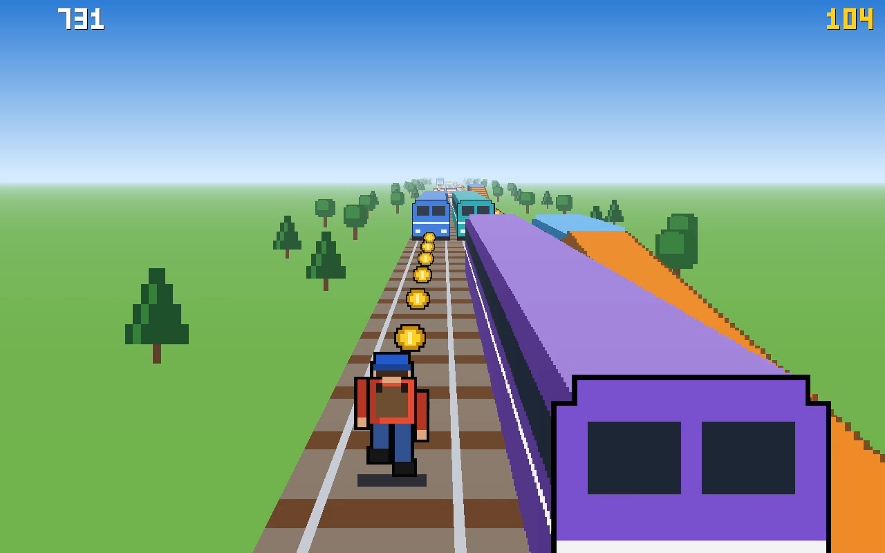

# subway surfers uefi

subway surfers as a uefi app. the pc's firmware boots it straight off the drive, no windows or linux in between. the whole thing is 3,214 bytes of x86-64 assembly, and i wrote the pe header by hand so there's no linker.



video: https://youtu.be/C-_rOv8anmI

## running it

you need nasm and qemu (qemu ships the edk2 firmware it boots with).

```
nasm -f bin game.asm -o game.efi
```

then copy game.efi to `esp/EFI/BOOT/BOOTX64.EFI` and boot qemu with the edk2 code file and `fat:rw:esp` as the drive. `run.bat` does both on windows, just fix the qemu path if yours is somewhere else.

left and right change track, up jumps, down rolls. when you crash, press space.

i've only run it in qemu. a normal pc with secure boot on won't start it because the file isn't signed.
